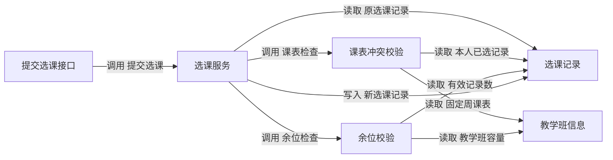

# M3 项目图形版本对照

在「项目知识 → 项目架构与业务流程 → 版本对照」选择两个已确认的项目基线，再选择架构图、业务流程泳道图或业务时序图。泳道图按流程查看，时序图按流程和场景查看。旧版本选「首次发布前」可查看首轮新增的内容。也可以跨轮比较。

- 「变化叠加」在 Mermaid 图中用文字和颜色标出新增、修改和删除。架构和泳道图用红色虚线显示旧版已删除的节点或连线。
- 「左右对照」同时显示两个原版图。「仅旧版」与「仅新版」可分别查看固定版本。
- 图表默认适应宽度。点击「按原尺寸查看」可放大文字并滚动查看。展开「查看变更说明」可读前后内容及变更类型。
- 「下载对照 Markdown」保存同一对版本、同一图表的叠加图、两张原版图及变更说明。

时序图按新版顺序绘制消息，已删除消息单独作为注释标出旧版序号。带稳定标识的消息可以逐条比较。双方都有场景但存在无标识的历史消息时，场景显示整体变化，两侧原图提供具体内容。新增或删除整个场景时，其消息随该场景一起标记。

## 选课三轮验收

验收使用独立的「选课 M3 · 图形版本对照验收」项目。三轮均由现有教学导入和项目基线提案流程确认。基线编号 v1、v2、v3 分别对应教学版本 v1、v1.1、v1.2。

| 对照 | 页面可见结果 |
|---|---|
| [首次发布前 → 基础选课](http://127.0.0.1:8000/workbench/#/projects/74867b66-2eb2-47e6-829b-91a0b219edef/knowledge?baseline=1&compare=0) | 架构模块、提交流程和成功时序标为新增。左右对照的旧版为空。 |
| [基础选课 → 容量限制](http://127.0.0.1:8000/workbench/#/projects/74867b66-2eb2-47e6-829b-91a0b219edef/knowledge?baseline=2&compare=1) | 架构新增余位校验。流程新增检查余位和满员拒绝，原首次选课直达写入的分支标为删除。成功时序新增余位相关消息，写入消息标为修改。可另选「满员拒绝新增」场景。 |
| [容量限制 → 时间冲突](http://127.0.0.1:8000/workbench/#/projects/74867b66-2eb2-47e6-829b-91a0b219edef/knowledge?baseline=3&compare=2) | 架构新增课表冲突校验。流程新增冲突判断和拒绝分支，原首次选课直接进入余位检查的分支标为删除。成功时序新增课表消息，写入消息标为修改。可另选「课表冲突拒绝新增」场景。 |

另外核对了基础版直接对照时间冲突版、单独查看旧版或新版、移动视口和 Markdown 下载。架构节点、依赖和时序消息的删除使用独立对照样例验证实际渲染。已确认的选课三轮展示了业务流程中的真实删除分支。原选课教学项目的三个基线继续可读，旧时序使用场景级对照。

## 实现与接口

比较从两个不可变项目基线读取模型，沿用稳定的领域、模块、流程、步骤、场景及消息键。历史依赖和分支缺少独立键时使用同向端点识别。删除项的几何位置由 Mermaid 对合成视图重新布局。原版视图与历史导出仍读取各自基线，叠加视图即时生成。

`GET /workbench/projects/{project_id}/project-model/comparison` 接收 `before_version`、`after_version`、`kind` 及可选的 `process_key`、`scenario_key`。旧版用 `0` 表示首次发布前。追加 `/markdown` 获取同一图形的 Markdown 对照。两个版本必须属于同一项目，且均来自确认发布的基线。

验收数据和本机工作台保留。浏览器验收的任务标识和截图分别保存在 `.local/m3-course-manifest.json` 和 `.local/m3-browser/`。

## 架构展示的优化建议

将现有图定位为「逻辑结构」。领域、模块和子模块说明职责归属，适合继续用树导航。总览按领域分组，默认展示一级模块和跨领域协作，点选模块后展开子模块。图中的包含关系用分组边界表达，减少横跨画布的归属箭头。节点展示类型、名称和一句职责，详情再给出接口、数据、关联需求和规则的固定版本。这个层次可沿用 arc42 的构建块视图。 [arc42 构建块视图](https://docs.arc42.org/section-5/)

| 建议视图 | 回答的问题 | 选课示例 |
|---|---|---|
| 系统上下文 | 谁使用系统，哪些外部系统与它交换信息？ | 学生使用选课系统浏览教学班、提交选课、查看个人已选列表。按有依据的系统边界绘制。 |
| 逻辑结构与职责 | 哪个模块对哪项能力负责？ | 选课服务办理请求，余位校验负责容量规则，课表冲突校验负责时段规则。 |
| 接口与协作 | 谁调用什么能力，读写哪些数据？ | 提交选课接口调用选课服务。余位校验读取教学班容量及有效选课记录。 |
| 运行场景 | 一次请求经过哪些步骤，何时成功或拒绝？ | 用泳道图看分支，用时序图看首次成功、重复请求、满员和课表冲突的交互。 |
| 运行单元与部署 | 应用、进程和数据存储在哪里运行？ | 根据实际代码、配置或部署记录补充运行单元、存储和协议。余位校验、课表冲突校验仍可属于同一运行单元。 |

系统上下文、运行单元、组件可以借鉴 C4 的不同观察层级。用统一图例说明关系类型，每条箭头的文字和方向一致。运行场景沿用结构视图中的模块标识，便于从拒绝分支反查责任方。 [C4 图形层级](https://c4model.com/diagrams) · [C4 图形标注](https://c4model.com/diagrams/notation) · [arc42 运行视图](https://docs.arc42.org/section-6/)

协作视图建议从系统现有的「调用、读取、写入、依赖」四种语义开始。调用从发起方指向接口或被调用方，读取和写入从操作者指向数据对象。保留「依赖」描述只确认了静态依赖的关系。关系标签写清具体动作和对象。点击关系后可查看对应接口、设计依据和关联需求。当前单需求设计已提供职责图与协作图，可以在原三轮复验项目的容量需求交付页查看。 [容量设计交付](http://127.0.0.1:8000/workbench/#/projects/b694579e-8ebb-4390-9bbe-e9eb8c53e4d5/knowledge?requirement=f25fe8b1-8b68-575d-bf28-8093c4d488d0&version=1&design=aa65b8ed-100e-4fa3-ae56-cc3a31002b41)

下面是建议的选课协作视图，省略目录浏览和已选列表两条路径。

第一步可把已审阅的协作关系接入项目基线，保存关系类型、稳定键、端点、固定接口或数据引用及设计依据。基线和需求设计之间通过显式引用对应组件，遇到不同名称时由审阅人确认归属。页面支持切换「逻辑结构」「接口与协作」，再从关系定位关联的泳道和时序场景。沿用 M3 的颜色和文字标记展示两版确认内容的变化，M2 的潜在影响通过单独入口查看。选课服务的事务边界、并发保护和失败回滚可放在关系详情或场景说明中，结合对应的测试证据核对。

### 已实现的架构双视图

进入「项目知识 → 项目架构与业务流程 → 架构总览」。在「逻辑结构」查看领域分组和一级模块，展开目录查看子模块及职责。点「接口与协作」查看显式调用、读写和静态依赖。展开「关系与依据」下的条目，可以查看理由、固定接口或数据模型版本，并跳到对应的流程和时序场景。

选课示例的协作关系随项目基线提案发布。提交选课接口和两个数据视图引用该轮确认的知识版本。图中的「教学班信息」和「选课记录」共用同一选课数据模型依据。旧基线可以直接使用新的逻辑结构视图，协作页按该基线记录的内容展示。

| 已确认基线 | 核对项 |
|---|---|
| 基础选课 | 5 条关系，包含提交调用、查询原记录及保存新记录。 [基础协作图](http://127.0.0.1:8000/workbench/#/projects/c2284346-e6c8-4e39-b2d7-3640d0498414/knowledge?baseline=1&arch=collaboration) |
| 容量限制 | 8 条关系，新增余位调用、容量读取和有效记录统计。 [容量协作图](http://127.0.0.1:8000/workbench/#/projects/c2284346-e6c8-4e39-b2d7-3640d0498414/knowledge?baseline=2&arch=collaboration) |
| 时间冲突 | 11 条关系，新增课表检查及其读写依据。展开「读取目标和已选教学班时段」，点「时序 · 课表冲突拒绝新增」。 [时间冲突协作图](http://127.0.0.1:8000/workbench/#/projects/c2284346-e6c8-4e39-b2d7-3640d0498414/knowledge?baseline=3&arch=collaboration) |

在「版本对照」的图表下拉框选择「接口与协作图」，容量到时间冲突的变化叠加会标出新增的课表调用与读取，以及写入依据的变化。这里也支持左右对照和 Markdown 下载。 [查看容量到时间冲突的协作差异](http://127.0.0.1:8000/workbench/#/projects/c2284346-e6c8-4e39-b2d7-3640d0498414/knowledge?baseline=3&arch=collaboration&compare=2)

## 用现有页面复核三轮需求

1. 选择「选课 M3 · 图形版本对照验收」，点击「项目知识」。在「知识目录」选择「需求」，依次打开「基础选课与已选列表」「教学班容量限制」「教学班课表时间冲突校验」。点「需求分析文档」，核对下面的业务检查点。项目基线下拉框切换的是图形版本。核对单条需求时使用需求交付区的「需求版本」。
2. 展开「项目架构与业务流程」并点「版本对照」。按本页三轮对照链接切换，先选「项目架构图」，再选「业务流程泳道图 → 提交选课」，最后选「业务时序图 → 首次选课成功」。容量轮追加检查「满员拒绝新增」，时间冲突轮追加检查「课表冲突拒绝新增」。点「左右对照」确认旧图和新版各自的实际内容。要留档时点「下载对照 Markdown」。
3. 查看已经保存的需求设计和代码时，打开原「校园选课系统 · 三轮复验」对应的交付链接，使用「已确认设计」固定到本轮，再切换「需求分析文档」和「设计文档」。点左侧「工程工作区」，选择同轮工作区，核对「设计来源」、文件快照和「代码生成与审阅」里的已保存候选。后两轮可核对「继承的代码快照」。 [基础交付](http://127.0.0.1:8000/workbench/#/projects/b694579e-8ebb-4390-9bbe-e9eb8c53e4d5/knowledge?requirement=ceadf66e-df26-5119-94cd-58ee081ecc4d&version=1&design=ec72db7f-c4ab-4492-a084-97646b3f853d) · [容量交付](http://127.0.0.1:8000/workbench/#/projects/b694579e-8ebb-4390-9bbe-e9eb8c53e4d5/knowledge?requirement=f25fe8b1-8b68-575d-bf28-8093c4d488d0&version=1&design=aa65b8ed-100e-4fa3-ae56-cc3a31002b41) · [时间冲突交付](http://127.0.0.1:8000/workbench/#/projects/b694579e-8ebb-4390-9bbe-e9eb8c53e4d5/knowledge?requirement=2c51842a-b755-5fd9-b8c2-0ee76ffb998c&version=1&design=1ad32b62-b1db-4fde-bbce-dba313ad4db0)

| 轮次 | 需求和设计检查点 | 图形检查点 |
|---|---|---|
| v1 基础选课 | 浏览教学班，首次新增，重复请求返回原记录，学生已选列表隔离。 | 「是否已有选课记录」分为返回原记录与首次写入。 |
| v1.1 容量限制 | 零容量与满员拒绝新增，最后一个名额并发至多一人成功，已选学生重复请求仍返回原记录。 | 余位校验、满员分支和时序场景出现，首次选课改为先检查余位。 |
| v1.2 时间冲突 | 同一学生的固定周课表按闭区间节次检查。重叠拒绝，相邻且不重叠允许。容量和重复请求规则继续适用。 | 首次选课依次经过课表与余位检查，重复路径仍直接返回原记录。 |

原三轮复验归档含三轮源码、代码差异和实际运行的 5、8、13 项测试日志。要从工程工作区重新运行，确认页面显示「隔离执行器可用」，填写操作署名和依据，再点「执行当前已保存快照」。在「真实执行记录」核对该快照摘要、测试数量、退出码和日志。 [原三轮验收索引](../.local/course-review-artifacts/验收索引.md) · [隔离执行器配置](requirements-design-guide.md#配置隔离执行器)

如果要重新走模型生成链路，可在「需求设计」逐轮绑定累计需求和业务规则，确认设计后进入「工程工作区」。基础轮从空工作区开始，后两轮各继承上一轮已保存的快照。审阅本轮代码及新增测试后保存，并运行当前快照。 [三轮需求、设计与代码验收](requirements-design-guide.md#从新项目验收选课的三轮需求设计和代码)

## 在学生页面实际验证选课

上面两个项目分别提供图形基线和工程产物。学生页面由完成的「选课教学适配器」流程打开。要亲手完成三轮业务点击，在顶部点「创建项目」，填写「选课三轮手工验证」及操作署名。三轮都在这一个练习项目里进行。

1. 依次处理 `v1`、`v1.1`、`v1.2`。每轮进入「项目知识 → 选课教学案例：导入一轮知识」，选择本轮「教学版本」，填写署名，点「提出选课知识提案」。在提案页填写「审核依据」，点「校验当前提案」，通过后勾选确认并点「确认提交当前提案」。核对本轮新增需求和前轮需求同时可查。
2. 点左侧「验证流程 → 新建 ＋」，选「通用流程：绑定已有知识」「选课教学适配器」和本轮版本。流程名称可填「选课 v1.1 容量限制验证」，目标用上表本轮检查点，填写署名。核对预选的需求和业务规则随轮次累计，绑定测试用例为「基础选课与幂等验收定义」。点击「创建草稿流程」。
3. 在「变更审阅」校验并确认提交初始化提案，点「启动流程」。按需求分析、架构设计、代码实现、测试验证四阶段，逐次完成「运行本阶段参考 Agent → 审阅、校验及提交阶段产物 → 确认任务完成 → 生成阶段门禁 → 审阅、校验及提交门禁 → 放行并推进阶段」。每次按对话框填写操作署名和依据。详细按钮和各阶段通过条件见教学流程教程。 [每个阶段的完整操作](phase4-enhancement.md#每个阶段的完整操作)
4. 每轮达到「已完成」和 `4/4` 后，点击「代码与测试」。三轮应分别看到 5、8、13 项测试通过，进程退出码为 0。展开「查看执行日志与固定命令」，再点「打开选课业务应用」。每轮业务数据按流程独立保存，以下步骤以新流程首次打开时的数据为准。

要在练习项目同时查看每轮图形，在本轮知识提案提交后，展开「项目架构与业务流程 → 建立项目基线提案」，选择相同的教学版本，点「提出选课项目基线」。校验并确认提交后，到「版本对照」选择本轮和前一轮。

| 轮次 | 按顺序点击 | 应看到的结果 |
|---|---|---|
| 基础选课 | 选 S001，点「选择 O101」，再点一次。切换 S002，再切回 S001。 | 首次成功，重复返回原记录。S002 列表为空，S001 保留一条 O101。 |
| 容量限制 | S001 选 O101。切换 S002，分别选 O101 和 O104。切回 S001 再选 O101。 | O101 达到 `1/1` 后拒绝 S002，零容量 O104 保持 `0/0`。S001 的重复请求仍成功返回原记录。 |
| 时间冲突 | S001 依次选 O101、O102、O103，再重复选 O101。切换 S002 选 O101。 | O101 成功。O102 与 O101 共享周一第 2 节而拒绝，人数保持 `0/2`。O103 从第 3 节开始，可选。重复 O101 返回原记录，S002 仍受满员限制。 |

最后一个名额和同一学生并发选择冲突教学班的判定，以「代码与测试」的并发用例及执行日志为准。手工页面用来核对成功、拒绝、人数和个人列表。
