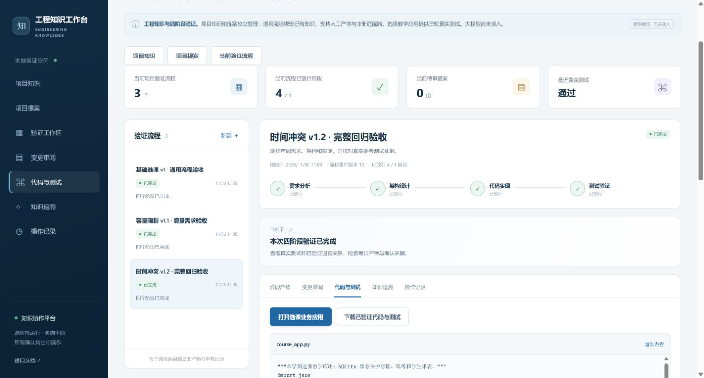

# 通用流程与选课验证指南

第四阶段补强把项目知识、变更提案和四阶段流程连接起来。项目没有流程时，也能浏览和维护知识；创建流程时明确选择已有知识版本，复用稳定身份。原有订单参考流程继续支持。本指南的选课教学流程使用固定适配器，无需大模型，由人主动建立版本、发起流程和审核变更。若要自行创建需求并使用模型生成设计，请使用新增的[需求与模型设计指南](requirements-design-guide.md)；阶段五的自动持续演进仍未实施。

## 页面入口

| 页面 | Hash 路由 |
|---|---|
| 项目知识、关系、实体历史与影响检查 | `/projects/:projectId/knowledge` |
| 项目全部提案 | `/projects/:projectId/proposals` |
| 任意项目提案的差异与审核历史 | `/projects/:projectId/proposals/:proposalId` |
| 流程阶段产物、代码测试、追溯和历史 | `/workflows/:id/...` |

入口为 `http://127.0.0.1:8000/workbench/`。顶部项目快捷入口在窄屏也可使用。没有流程时流程菜单禁用，不再把每个菜单都作为项目首页入口。

## 三轮练习的安排

按本教程建立一个项目，在同一项目下完成三个流程。每一轮都经过需求分析、架构设计、代码实现、测试验证四个阶段，再打开对应的选课应用操作。前一轮完成后才导入下一轮。

| 轮次 | 教学版本 | 流程名称示例 | 本轮增加的能力 | 实际测试数量 |
|---|---|---|---|---:|
| 第一轮 | v1 | 选课 v1 基础选课验证 | 查询目录、选课、已选列表、重复请求处理、学生隔离 | 5 |
| 第二轮 | v1.1 | 选课 v1.1 容量限制验证 | 保留基础能力，增加零容量、满额及并发限额保护 | 8 |
| 第三轮 | v1.2 | 选课 v1.2 时间冲突验证 | 保留前两轮能力，增加课表重叠及同学生并发冲突保护 | 13 |

练习使用“选课教学适配器”，无需填写模型密钥。“导入一轮知识”会提供该轮已结构化的需求、规则和设计，适配器生成对应的内置教学实现并实际执行测试。它不会根据任意自然语言自动生成其他业务。请先沿用这三轮内容，完成后再考虑扩展。

## 创建选课项目

1. 打开[中文工作台](http://127.0.0.1:8000/workbench/)，确认顶部显示“服务已连接”。若显示未连接，先按 README 的启动说明启动本地服务。
2. 在顶部“当前项目”下拉框右侧，点击“＋”按钮。鼠标悬停提示为“创建项目”。
3. 在“创建验证项目”窗口填写以下内容。

| 字段 | 填写示例 |
|---|---|
| 项目名称 | 选课系统三轮验证 |
| 项目说明 | 验证基础选课，并逐轮增加容量限制和时间冲突要求，保留每轮需求、代码、测试及审批历史。 |
| 操作署名 | 教程操作者，或你的姓名 |

4. 点击窗口右下角“创建项目”。
5. 检查顶部“当前项目”已经切换为“选课系统三轮验证”，再在工作台导航中点击“项目知识”。

成功标志：能进入新项目的知识列表，初始没有选课需求和验证流程。后面三轮都保持选择这个项目，不再创建另外两个项目。署名用于本地记录，不是学生账号或平台登录。

## 第一轮基础选课

### 导入并确认基础知识

1. 在“项目知识”页面，展开“选课教学案例：导入一轮知识”。
2. “教学版本”选择 `v1`；“操作署名”填写“教程操作者”。
3. 点击“提出选课知识提案”。页面自动跳到“项目变更提案”，打开“选课知识 v1”。
4. 阅读候选内容，至少找到“基础选课与已选列表”，核对目录、首次选课、重复请求返回原记录、学生列表隔离四条验收条件；同时确认有唯一与幂等规则，以及组件、接口、数据模型、代码规划和测试定义。
5. 滚动到本页审核表单，填写“操作署名”和“审核依据”。依据示例：“已核对基础选课、重复请求和学生隔离的验收条件，本轮仅使用预置学生和单学期教学范围。”
6. 点击“校验当前提案”，等待状态变为“校验通过”。
7. 校验完成后，再勾选“我已阅读本次变更内容及依据，确认提交时会写入知识库。”，点击“确认提交当前提案”。
8. 点击“返回项目知识”，查看新增知识。

成功标志：提案为“已提交”，项目知识页能找到基础需求及其规则、设计、代码和测试定义。新知识显示“草稿”是正常的；此时确认的是需求和计划，还没有执行选课业务。若校验未通过，应先处理页面错误，不能按成功继续。

### 创建基础选课流程

1. 在工作台导航中点击“验证流程”，再点击流程列表的“新建 ＋”。
2. 在“新建验证流程”窗口按下表填写。执行方式初始可能是人工提交，应明确改为“选课教学适配器”。

| 字段 | 选择或填写内容 |
|---|---|
| 流程模式 | 通用流程：绑定已有知识 |
| 执行方式 | 选课教学适配器 |
| 教学版本 | v1 |
| 流程名称 | 选课 v1 基础选课验证 |
| 验证目标 | 验证预置学生能浏览教学班、完成基础选课、查看自己的已选列表，重复请求不产生重复记录。 |
| 操作署名 | 教程操作者 |

3. 等待已有知识加载，核对下列选中项。这里复用刚才确认的知识，不需要填写技术编号或再次新建同名需求。

| 绑定字段 | 第一轮应选中 |
|---|---|
| 绑定需求 | 基础选课与已选列表 |
| 绑定架构组件 | 选课服务 |
| 绑定接口契约 | 选课 HTTP 接口设计 |
| 绑定数据模型 | 选课数据模型设计 |
| 绑定代码资产 | 选课服务待实现代码 |
| 绑定测试用例 | 基础选课与幂等验收定义 |
| 额外业务规则（固定版本） | 同一学生同一教学班的选课保持唯一与幂等 |

选择执行方式和教学版本后，表单会重新建议选中项，应先选好版本再检查绑定。多选框中只有选中的条目会提交，不是把框内所有候选都提交；Windows 上如需手工调整多选，可按住 Ctrl 点选，避免普通单击取消其他选中项。

4. 点击“创建草稿流程”。

成功标志：流程列表出现“选课 v1 基础选课验证”，状态为“流程草稿”，已放行 `0/4`，当前需要审阅初始化提案。表单中名称后面的 `v数字` 是知识修订序号，可能因先前操作而变化，不要求与本教程写死一致。

### 确认初始化并启动需求阶段

1. 在当前流程内点击页签“变更审阅”。
2. 点击“查看修改前后”，阅读初始化提案。这里会绑定已有知识、建立执行证据占位、补充缺少的追溯关系，必要时对齐关系两端版本。证据占位不代表测试已经通过。读完点击弹窗“关闭”。
3. 点击页面“校验提案”，在“校验当前提案”窗口填写“操作署名”和“操作依据”。依据示例：“已核对本轮绑定的是 v1 对应的基础选课需求、规则及技术产物，确认初始化范围。”点击窗口“校验当前提案”。
4. 提案显示“校验通过”后，点击页面“确认提交提案”。在“确认提交当前提案”窗口再次填写署名、依据，勾选“我已审阅本次变更内容及依据，确认提交。”，再点击“确认提交当前提案”。
5. 在“当前下一步”区域点击“启动流程 →”。在“启动需求阶段”窗口填写署名，依据可写“初始化提案已明确提交，开始本轮需求分析。”，点击“启动需求阶段”。

成功标志：流程变为“阶段运行中”，当前阶段为“需求分析”，下一步可以“运行本阶段参考 Agent”。

项目提案页与流程提案页的操作不同：项目提案在页面底部直接填写“审核依据”；流程动作会另开窗口，字段叫“操作依据”。流程页上的“确认提交提案”与窗口里的“确认提交当前提案”也要分别点击。

## 每个阶段的完整操作

三轮均使用下面的顺序。建议停留在当前流程的“变更审阅”页；“当前下一步”位于流程上方，校验和提交按钮位于当前提案下方。每次操作后等待处理完成和状态更新，再继续下一步。

每个流程动作窗口都要填写“操作署名”和“操作依据”。署名可一直使用“教程操作者”；依据要结合实际看到的内容填写，不能仅因示例写了通过就确认。

| 步骤 | 点击哪里 | 窗口填写与确认 | 成功标志 |
|---|---|---|---|
| 1 运行当前阶段 | “当前下一步”中的“运行本阶段参考 Agent →” | 依据可写“基于本轮已确认的需求和规则，形成当前阶段产物供审阅”；点击“运行本阶段参考 Agent” | 出现新的“阶段产物提案”，状态“待校验”；尚未放行 |
| 2 阅读候选产物 | 当前提案旁“查看修改前后” | 核对下表中的本阶段重点，读完关闭弹窗 | 能解释本次具体修改及对应版本 |
| 3 校验产物 | 当前提案下方“校验阶段产物” | 依据可写“已核对本阶段产物、验收声明与固定版本”；点击窗口“校验阶段产物” | 阶段产物提案校验通过；若有错误先处理 |
| 4 提交产物 | “确认提交提案” | 依据可写“已审阅候选产物及依据，确认保存本次变更”；勾提交确认框，点击“确认提交当前提案” | 阶段产物提案“已提交” |
| 5 完成阶段任务 | “当前下一步”中的“确认任务完成 →” | 依据可写“本阶段产物提案已提交，确认阶段任务完成”；点击“确认阶段任务完成” | 下一步变为“生成阶段门禁” |
| 6 生成门禁 | “当前下一步”中的“生成阶段门禁 →” | 依据可写“任务已完成，核对产物完整性及版本后准备放行”；点击“准备阶段放行提案” | 流程“待确认阶段门禁”，出现另一份“阶段门禁提案” |
| 7 审阅门禁 | 门禁提案旁“查看修改前后” | 核对产物状态、关系端点版本和证据的变化，读完关闭 | 当前审阅的是门禁提案，不是刚提交的产物提案 |
| 8 校验门禁 | 门禁提案下方“校验提案” | 依据可写“已核对门禁涉及的产物状态、关系和适用版本”；点击“校验当前提案” | 门禁提案“校验通过” |
| 9 提交门禁 | “确认提交提案” | 填写依据，勾提交确认框，点击“确认提交当前提案” | 门禁提案“已提交”，阶段仍需最后放行 |
| 10 放行阶段 | “当前下一步”中的“放行并推进阶段 →” | 依据可写“产物和门禁均已确认，允许进入下一阶段”；勾“我已核对阶段门禁及其产物，确认放行。”，点击“确认放行并推进” | 前三阶段进入下一阶段；最后阶段流程“已完成” |

界面按钮仍叫“参考 Agent”，本教程中它运行的是所选的选课教学适配器。主线使用这个按钮；“人工提交本阶段产物”是另一种输入方式，本教程无需使用。

### 各阶段要看什么

| 当前阶段 | 在候选内容和正式产物中核对 | 放行后 |
|---|---|---|
| 需求分析 | 本轮累计需求都有明确验收条件；没有丢失前一轮需求，也没有加入适配器不支持的新业务 | 已放行 `1/4`，进入架构设计 |
| 架构设计 | 组件职责、接口设计、数据模型与本轮范围一致；基础轮关注幂等，第二轮增加事务内的容量校验，第三轮增加课表冲突校验 | 已放行 `2/4`，进入代码实现 |
| 代码实现 | 出现 `course_app.py` 源码和内容摘要；代码证据固定到对应代码版本 | 已放行 `3/4`，进入测试验证 |
| 测试验证 | “代码与测试”页出现独立测试源码和真实执行记录；数量、退出码、结果符合本轮要求 | 已放行 `4/4`，流程已完成 |

“阶段产物”页展示已经提交的正式知识；刚运行生成、尚未提交的候选内容要在“查看修改前后”里阅读。差异弹窗只列变化字段，未变化的验收条件或设计结构可能不会重复出现。若要核对完整内容，点击“阶段产物”，找到对应卡片，点击“查看完整产物 ↗”，读取验收条件、组件职责、接口协议或数据结构；关闭后返回“变更审阅”继续校验和提交。

测试阶段先运行并读取实际结果，再确认产物、任务和最后门禁。看到“通过”后仍需完成表中后续确认步骤；直到 `4/4` 才算流程完成。

## 第一轮的执行与业务验收

### 查看真实测试

基础流程完成后，点击“代码与测试”，核对以下内容。

- “实际运行测试”为 **5**，“进程退出码”为 **0**，执行结果为“通过”。
- 展开“查看执行日志与固定命令”，能看到 `Ran 5 tests` 和 `OK`。
- 流程标题区域显示“已完成”，已放行阶段为 `4/4`。
- 页面出现“打开选课业务应用”和“下载已验证代码与测试”。

这5项测试覆盖目录、选课与查询、幂等、学生隔离及无效教学班。自动测试使用独立临时数据，不会预先填好下方业务应用的学生已选列表。

### 在业务应用中完成基础选课

点击“打开选课业务应用”，会打开单独的学生选课页面。保留原工作台页面，后续还要回来增加需求。先认识固定目录。

| 按钮对应教学班 | 课程 | 容量 | 每周时间 |
|---|---|---:|---|
| O101 | 高等数学 | 1 | 周一第1～2节 |
| O102 | 程序设计 | 2 | 周一第2～3节 |
| O103 | 大学英语 | 2 | 周一第3～4节 |
| O104 | 实验课程 | 0 | 周二第1～2节 |

v1 页面已经显示容量和时间列，但这一轮尚未启用容量和时间冲突限制；不要提前按后两轮的规则判断失败。

| 顺序 | 点击操作 | 应看到的结果 |
|---|---|---|
| 1 | “当前学生”选择 S001，点击高等数学行“选择 O101” | 提示“选课成功”；“我的已选教学班”出现“高等数学 · O101”；人数变为 `1/1` |
| 2 | 仍为 S001，再点击“选择 O101” | 提示“已选过，返回原记录”；列表仍只有一条，人数仍为 `1/1` |
| 3 | “当前学生”切换为 S002 | S002 的已选列表为空；目录人数仍为全体学生共享的 `1/1` |
| 4 | 切回 S001 | 原有 O101 记录仍在，证明两名学生的已选列表相互隔离 |

第一轮成功条件：四阶段 `4/4`，5项实际测试通过，手工选课、重复请求和学生隔离均与上表一致。

## 第二轮增加容量限制

### 在同一项目提交新增需求

1. 回到原工作台浏览器页，确认顶部仍是“选课系统三轮验证”，并确认基础流程已完成。
2. 点击“项目知识”，展开“选课教学案例：导入一轮知识”。
3. “教学版本”改为 `v1.1`，填写署名，点击“提出选课知识提案”。
4. 在项目提案页阅读变化：新增“教学班容量限制”、规则“教学班新增选课不得超过容量”和“零容量、满员与并发限额验收定义”；组件、接口、模型和代码规划也随之修订，基础需求继续保留。
5. 审核依据填写：“增加容量限制：零容量和满员时拒绝新增选课，最后名额并发不能超额，已有选课重复请求仍返回原记录。”
6. 点击“校验当前提案”，校验通过后勾确认框，点击“确认提交当前提案”。

成功标志：提案“已提交”；“项目知识”能找到新增容量需求，并且原基础需求还在。本轮通过版本导入正式增加需求，不用再手工新建一个同名容量需求。

### 新建容量流程并完成四阶段

1. 在验证流程列表点击“新建 ＋”，再次确认模式为“通用流程：绑定已有知识”、执行方式为“选课教学适配器”、教学版本为 `v1.1`。
2. 流程名称填“选课 v1.1 容量限制验证”；验证目标填：“保留基础选课和幂等，验证零容量、满员拒绝及最后名额的并发保护。”；署名仍填“教程操作者”。
3. “绑定需求”应同时选中“基础选课与已选列表”和“教学班容量限制”。“额外业务规则（固定版本）”应同时选中唯一与幂等规则、容量规则。
4. 架构、接口、模型、代码、测试仍按第一轮表格各选一项；“绑定测试用例”只选“基础选课与幂等验收定义”。新增加的容量验收定义不要额外选入这个槽位：本轮实际运行的组合回归测试已经包含容量用例。
5. 点击“创建草稿流程”，按前文完成初始化的审阅、校验、提交及启动。
6. 对需求、架构、代码、测试四阶段，分别执行完整的10步操作。
7. 完成后打开“代码与测试”，确认 **8项测试、退出码0、通过、流程4/4**，日志有 `Ran 8 tests` 和 `OK`。

这8项是在基础5项上增加满额、零容量及最后一个名额的并发测试。并发边界由实际自动测试覆盖，不需要靠手工连续点击模拟。

### 在第二轮业务应用验证容量

在容量流程的“代码与测试”页点击“打开选课业务应用”。这一轮的数据独立于基础流程，因此先前 v1 的选课不会出现在这里。按下面顺序操作。

| 顺序 | 点击操作 | 应看到的结果 |
|---|---|---|
| 1 | S001 点击“选择 O101” | “选课成功”，高等数学人数 `1/1`，S001 列表有 O101 |
| 2 | 切换 S002，点击“选择 O101” | “教学班已满，不能新增选课”；人数仍为 `1/1`，S002 列表没有 O101 |
| 3 | S002 点击“选择 O104” | 同样提示已满；实验课程仍为 `0/0`，S002 列表没有 O104 |
| 4 | 切回 S001，再点击“选择 O101” | “已选过，返回原记录”，不会因满员拒绝原有请求，也不重复增加人数 |

第二轮成功条件：新增容量行为生效，同时原有选课与幂等行为保留，8项实际测试通过，流程 `4/4`。

## 第三轮增加时间冲突要求

### 提交时间冲突需求并创建流程

1. 回到工作台，确认容量流程已经完成 `4/4`；保持同一个项目。
2. 进入“项目知识”，展开教学导入，选择 `v1.2`，填写署名，点击“提出选课知识提案”。
3. 阅读新提案，确认新增“教学班课表时间冲突校验”、规则“同一学生已选教学班的固定周课表不可重叠”及“闭区间课表冲突与并发验收定义”，并保留基础与容量要求。
4. 审核依据填写：“同一学生固定周课表不能重叠，按闭区间检查节次；相邻不重叠时段允许选课，并保留容量和幂等回归。”
5. 先点“校验当前提案”，校验通过后再勾选并“确认提交当前提案”。
6. 在验证流程列表点击“新建 ＋”，选择“通用流程：绑定已有知识”“选课教学适配器”和 `v1.2`。
7. 流程名称填“选课 v1.2 时间冲突验证”；目标填：“增加固定周课表冲突检查，拒绝重叠教学班，允许不重叠的相邻时段，并保留容量、并发和幂等行为。”；填写署名。
8. “绑定需求”选中基础、容量、时间冲突三条；“额外业务规则（固定版本）”选中唯一与幂等、容量、固定周课表不可重叠三条。
9. 架构、接口、模型、代码仍各一项；“绑定测试用例”仍只选“基础选课与幂等验收定义”，不要额外选入两个独立验收规划条目。
10. 创建草稿，完成初始化确认及启动，再逐阶段执行完整10步。

成功标志：最终流程 `4/4`，“代码与测试”显示 **13项测试、退出码0、通过**，日志有 `Ran 13 tests` 和 `OK`。本轮包含之前的容量回归，以及闭区间冲突、相邻时段、不同星期、多时段和同一学生并发冲突检查。

### 在第三轮业务应用验证冲突和回归

点击第三轮流程中的“打开选课业务应用”。使用这一轮的新数据，按以下顺序操作。

| 顺序 | 点击操作 | 应看到的结果 |
|---|---|---|
| 1 | S001 点击“选择 O101” | “选课成功”，S001 列表出现高等数学 |
| 2 | S001 点击“选择 O102” | “与已选教学班上课时间冲突”；O102 仍为 `0/2`，S001 列表没有程序设计 |
| 3 | S001 点击“选择 O103” | “选课成功”；列表有 O101 与 O103，大学英语人数 `1/2` |
| 4 | S001 再点击“选择 O101” | “已选过，返回原记录”；S001 仍只有两条记录 |
| 5 | 切换 S002，点击“选择 O101” | “教学班已满，不能新增选课”；S002 没有新增记录，容量限制仍生效 |

O101 为第1～2节，O102 为第2～3节，两者共享第2节，所以冲突。O103 从第3节开始，与第1～2节不重叠，因此允许。时间判断使用闭区间，并以当前学生的课表为准。

第三轮成功条件：13项实际测试通过，重叠课程被拒绝、不重叠课程成功，原容量和幂等行为保留，四阶段全部放行。

## 核对三轮历史及最终结果

1. 在工作台的“验证流程”列表中，确认同一项目下有三个流程，均显示“已完成”。逐个点击，检查各自是 `4/4`，测试数量依次为5、8、13。
2. 打开第三轮“知识追溯”。检查基础、容量、时间冲突需求到“选课实现 v1.2”的“由其实现”，以及到“选课回归测试 v1.2”的“由其验证”，状态为“已验证”。
3. 不要求全部关系都变绿：“包含”“依赖”等关系，以及额外容量／冲突验收规划对应的关系，可能仍为“待确认”。真正执行并形成证据的是本轮绑定的组合回归测试。
4. 点击“操作记录”，查看运行、产物提交、阶段门禁与放行记录；在“项目提案”中可查看三次知识导入和其他提案的审核历史。
5. 返回“项目知识”，点击某条知识的“历史与影响”，可以查看不可变修订历史。只查看时不必点击“建立待审提案”。
6. 再点回基础流程的“代码与测试”，仍应看到 v1 源码和5项测试，不能被第三轮的13项记录替换。项目知识页显示当前最新知识，已完成的旧流程显示当时归档的具体版本。
7. 如需保存结果，在已完成流程的“代码与测试”页点击“下载已验证代码与测试”。ZIP 包含对应版本的源码、独立测试、启动入口和中文说明。

平台已完成的三轮页面示例：

## 常见卡点与重做方法

| 现象 | 应如何继续 |
|---|---|
| 新建流程时没有可绑定的知识 | 回到“项目知识”导入本轮版本，并完成项目提案的校验和提交；确认顶部项目正确，重新打开流程表单等待加载 |
| 校验或提交按钮是灰色 | 填写当前表单的署名和依据；提交时还需勾确认框。项目提案校验后确认框会重置，应在校验通过后再勾选 |
| 看不到“校验提案”或“校验阶段产物” | 进入当前流程的“变更审阅”页，关闭差异弹窗，按当前提案状态操作；刚运行的候选内容不在正式产物列表中 |
| 实现门禁提示未配置执行器 | 可能误选了默认人工模式；本教程应选择“选课教学适配器”。可取消不再使用的流程并新建正确定义的流程，不删除已有历史 |
| 创建时提示技术产物数量不匹配 | 选课适配器的架构、接口、模型、代码、测试每类恰好一项；测试只绑定基础组合测试条目 |
| 填写了新目标，但代码没有增加任意其他业务 | 标题和目标记录本轮意图，实际逻辑由所选教学适配器决定；缴费、先修课等需扩展需求与执行器 |
| 显示适配器范围不匹配 | 可能手工改动了本教程需求或规则；不要靠改标题绕过，需协调回教程范围或扩展执行器 |
| 显示版本或基线已变化 | 刷新并重新审阅，不能反复点击旧提交；若提前导入下一轮，旧流程可能已失去原基线，需要重新协调流程 |
| 测试显示通过，但还没有业务应用按钮 | 继续完成产物提交、确认任务、最后门禁的校验和提交，以及最后一次放行；最终必须是“已完成”与4/4 |
| 下一轮应用里没有前一轮的选课 | 每个流程的业务数据独立，需在当前流程应用重新选择；自动测试也不会给业务预览预置已选记录 |
| 刷新后已有手工选课，无法从空数据重试 | 同一流程会保留已选记录，当前没有退课或清空按钮。可绑定当前教学版本新建一个流程重新验证，不必重新导入同一来源版本 |
| 想重新从v1走到v1.2 | 建一个新的练习项目，从v1顺序开始；不要把再次导入旧v1当作回滚当前项目 |

教学版本 `v1/v1.1/v1.2`、知识修订序号、流程事件版本、提案事件版本是不同对象。操作时以当前页面读取的版本为准，无需手工填写这些数字。三轮共用稳定来源键，保留既有需求身份；修订序号递增是正常的。

## 本轮选课业务范围

预置学生 S001、S002、S003，单学期固定周课表。重复选择同一教学班返回已有记录。v1 仅基础选课；v1.1 增加容量为零、满额和并发最后名额保护；v1.2 增加闭区间时间重叠及同一学生并发选择冲突教学班的保护。

真实教学代码使用 SQLite 本地事务，人数由选课记录查询计算；数据库写事务串行保护容量、唯一性和课表检查。业务预览数据与平台 PostgreSQL 知识数据分开，按流程 UUID 保存在本机临时目录，`KNOWLEDGE_DEMO_DATA_DIR` 可指定持久目录。三个业务版本的预览数据相互独立。

该教学应用不是学校生产系统：没有登录、统一认证、学期管理、先修课、退课、单双周及候补能力。本轮沿用教程中的业务假设，没有据此推定学校实际政策。

下载 ZIP 中包含真实绑定版本的代码、独立测试、FastAPI 启动入口和 README。安装 FastAPI、Uvicorn 后，可运行 `python -m uvicorn app:app --port 8010`，访问 `http://127.0.0.1:8010/`；独立测试使用 `python -m unittest discover -p test_course_app.py -v`。

## 通用人工流程

项目知识页可建立需求等新知识草稿、修订已有知识、查看历史和影响，也能提出新关系提案。创建和修订均先产生提案；生命周期修订由服务端检查。高级类型属性使用 JSON 编辑，不自动从自由文本推断属性。

通用流程支持多条需求和多项技术产物绑定。每类至少一项；选课注册适配器限定一组代码和组合测试，适配器之外的额外测试定义保留为待确认规划关系，不会被误标为执行通过。

执行方式选择人工提交时，可点击“人工提交本阶段产物”，编辑绑定实体的完整修订内容，填写署名和依据后提交。提交只建立待审提案，之后仍需校验和明确提交。未配置可信执行器的人工流程会在实现或验证质量门禁处明确阻塞，不凭人工文字声明生成已验证关系。其他业务可通过同一绑定和提交契约接入独立执行器；目前没有任意代码执行入口。

关联图最多45项绑定知识（另有两项执行证据占位）；超过限制应拆分项目或输入。项目知识实体支持200项一页；关系与提案列表首版展示最近／当前200项。

## 版本与执行约束

- 初始化绑定、任务提交、知识提案和阶段门禁各自检查当前版本；旧页面遇到冲突应刷新并重新审阅，不能自动换版本重试写入。
- 初始化绑定与门禁显式对齐关联图中受影响关系的两端版本，并将需要复核的旧验证关系降回待确认，清除不适用的证据引用。
- 注册选课执行器只接受与所选教学版本匹配的需求、规则、代码和独立测试；创建时和每次阶段门禁都会复核需求与规则。流程内人工新增的业务要求超出适配范围时也会阻塞，需使用人工流程或扩展执行器。
- 服务端实际执行绑定代码文本，记录对应代码实体版本与代码／测试摘要。改动源码或拿其他任务的执行记录不能通过门禁。
- 原有四份数据库迁移不修改，本轮复用工作流定义与不可变事件存储。没有自动写入外部 Git、CI 或部署环境。

## 接口与维护位置

| 接口 | 用途 |
|---|---|
| `GET /workbench/projects/{id}/knowledge` | 项目实体、稳定来源键、关系及提案目录 |
| `POST /workbench/projects/{id}/course-import` | 以 release、actor 提出教学版本采集提案 |
| `POST /workbench/projects/{id}/relationships` | 提出关系候选，服务端检查端点项目及版本 |
| `POST /workflows` | scenario 选择 generic_v1，传入 executor、release、bindings、input_knowledge |
| `GET /workbench/workflows/{id}/artifact-draft` | 读取本阶段完整产物修订及流程版本 |
| `POST /workbench/workflows/{id}/artifacts` | 携带流程／任务版本、署名、依据和完整 changes，建立待审提案 |
| `GET /workbench/workflows/{id}/app` | 完成后开放对应版本业务预览 |
| `GET /workbench/workflows/{id}/bundle` | 下载已验证的代码、独立测试及启动入口 |

bindings 的 requirement、architecture、interface、data、code、test 六个槽位都使用 `{id, version}` 数组；input_knowledge 为额外固定版本输入。executor 当前允许 manual、course_selection_v1；release 为 v1、v1.1、v1.2。完整输入约束可在本地 `/docs` 查阅。

通用流程与质量门禁位于 `knowledge/generic_workflow.py`；教学源码与独立执行器位于 `course_application.py`、`course_executor.py`；页面所需服务位于 `platform_api.py`。扩展其他业务时应新增匹配其需求与独立验收测试的执行器，继续使用已有提案、版本及门禁契约。
